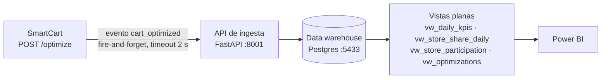
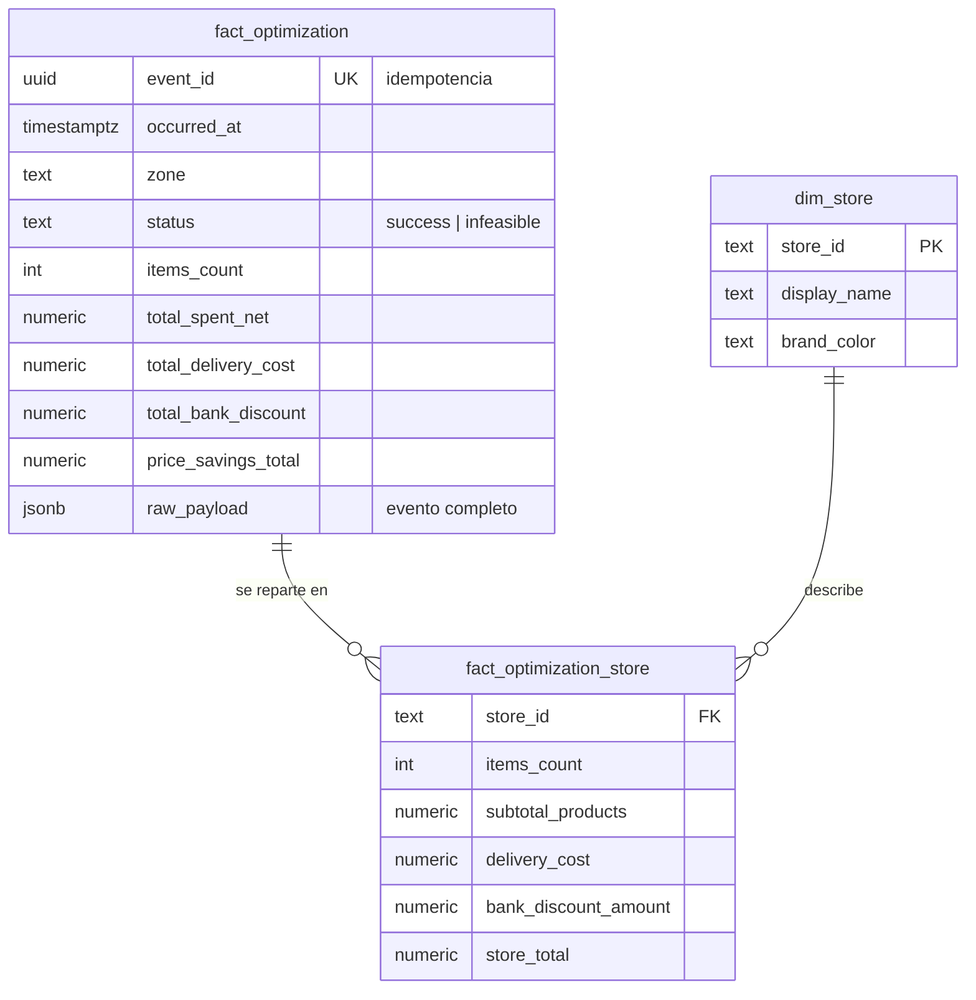

# SmartCart Performance Analysis

Microservicio analítico de [SmartCart](../SmartCart). Recibe un evento por cada carrito optimizado, lo persiste en un data warehouse PostgreSQL propio y expone vistas planas para armar KPIs de negocio en Power BI: **market share de cada supermercado, ahorro total generado y volumen de uso**.

Corre **independiente de la app principal**: su propio contenedor, su propio puerto, su propio venv. Si este servicio se cae, SmartCart sigue funcionando — el envío del evento es fire-and-forget.

## Arquitectura



Modelo en estrella: un hecho por carrito optimizado y otro por cada supermercado que participó de ese carrito.



> **Puertos.** El data warehouse usa **5433** y la API **8001**. La app principal ya ocupa 5432 (su Postgres con pgvector) y 8000 (su API). Los dos servicios conviven levantados al mismo tiempo.

## Cómo correrlo

### 1. Entorno

```powershell
python -m venv .venv
.\.venv\Scripts\Activate.ps1
pip install -r requirements.txt
Copy-Item .env.example .env
```

### 2. Data warehouse

```powershell
docker compose up -d
```

Levanta Postgres en `localhost:5433`. Los scripts de `db/init/` (schema, seed de tiendas, vistas) corren solos la primera vez.

> Postgres ejecuta `db/init/` **únicamente cuando crea el volumen**. Si cambiás el schema, hace falta `docker compose down -v` (borra todos los datos) o aplicar el cambio a mano con `psql`.

### 3. API

```powershell
uvicorn src.main:app --reload --port 8001
```

Docs interactivas en `http://localhost:8001/docs`.

### 4. Datos de prueba

```powershell
python scripts\seed_fake_events.py --n 500
```

Genera 500 eventos sintéticos de los últimos 90 días, respetando las reglas reales del negocio (mínimos de compra, envíos por zona, topes de descuento bancario). Quedan marcados con `source_env = 'seed'` para poder distinguirlos —y borrarlos— sin tocar datos reales:

```sql
DELETE FROM fact_optimization WHERE source_env = 'seed';
```

### Tests

```powershell
pytest
```

Corren contra el Postgres dockerizado (no contra mocks: lo que se verifica es el contrato con la base). Se saltan solos con un mensaje claro si el contenedor no está levantado.

## El evento

`POST /track-optimization` (alias: `/events/cart-optimized`), con header `X-API-Key`.

| Respuesta | Significado |
|---|---|
| `201 {"status":"stored","id":N}` | Guardado |
| `200 {"status":"duplicate"}` | Ya existía un evento con ese `event_id`; no se hizo nada |
| `401` | API key inválida o ausente |
| `422` | El payload no cumple el contrato |

```jsonc
{
  "event_id": "3f8c9d2e-...",              // UUID. Clave de idempotencia.
  "event_type": "cart_optimized",
  "schema_version": 1,
  "occurred_at": "2026-08-12T18:42:10.512Z", // OBLIGATORIO con zona horaria

  "source": { "app": "smartcart", "env": "dev", "version": "1.0.0" },
  "user": {
    "anon_user_id": "9f2b77c4-...",        // UUID de localStorage. Nullable.
    "zone": "CABA",
    "memberships": ["Comunidad Coto"],
    "cards": ["Visa Galicia"]
  },
  "cart": { "items": [{ "unified_id": "u_1a2b3c", "quantity": 2 }] },
  "result": {
    "status": "success",                   // o "infeasible"
    "total_spent_net": 84210.55,
    "price_savings_total": 6120.30,
    "excluded_stores": [],
    "split": {                             // tal cual lo devuelve /optimize
      "dia_online": {
        "products": [{ "unified_id": "u_1a2b3c", "quantity": 2, "total_cost": 5400.0 }],
        "subtotal_products": 41000.00,
        "delivery_cost": 2000.00,
        "bank_discount": { "card": "Visa Galicia", "amount": 4100.00 },
        "store_total": 38900.00
      }
    }
  },
  "engine": { "suggestions_count": 3, "strategic_swaps_count": 1,
              "coto_covered": true, "duration_ms": 812 }
}
```

Hay un ejemplo completo y válido en [`tests/fixtures/optimize_success.json`](tests/fixtures/optimize_success.json).

### Decisiones del contrato que conviene conocer

- **`event_id` es UNIQUE en la base.** El envío desde SmartCart es fire-and-forget y puede reintentar; sin esta restricción un reintento duplicaría la facturación de una tienda y ensuciaría el market share. Reintentar es seguro y esperado.
- **`occurred_at` tiene que traer zona horaria.** Se rechaza si no la trae. Interpretar un timestamp naive como UTC correría cada evento tres horas (el emisor está en UTC-3) y desalinearía todos los cortes diarios sin que nadie lo note.
- **Los carritos `infeasible` se guardan.** Un carrito que no alcanza los mínimos de compra es un KPI de fricción, no un error a descartar. Sus montos van a `NULL`, no a `0`: un cero se promediaría como una compra de $0 y hundiría el ticket promedio.
- **Los totales agregados los calcula este servicio**, no SmartCart. Una sola definición, en un solo lugar (`src/repository.py`).
- **Los campos desconocidos no rompen nada.** Entran igual y quedan en `raw_payload`.

## Modelo de datos

| Objeto | Grano | Para qué |
|---|---|---|
| `fact_optimization` | una optimización | Volumen de uso, ahorro, ticket, fricción |
| `fact_optimization_store` | optimización × supermercado | **Market share** |
| `dim_store` | supermercado | Nombres y colores del reporte |

`fact_optimization.raw_payload` guarda el evento crudo en JSONB. Es la red de seguridad: un KPI nuevo se puede backfillear desde los eventos ya recibidos, sin re-instrumentar SmartCart ni esperar meses a juntar datos.

## Power BI

**Conectar:** Obtener datos → Base de datos PostgreSQL → Servidor `localhost:5433`, Base de datos `smartcart_analytics`, modo **Import** (el volumen es chico; DirectQuery no aporta). Usuario y contraseña, los del `.env`.

**Importar sólo las vistas**, nunca las tablas: Power BI no sabe qué hacer con `JSONB` ni con `TEXT[]`, y las vistas ya vienen aplanadas.

| Vista | Grano | Contenido |
|---|---|---|
| `vw_optimizations` | una optimización | Header + partes de fecha ya calculadas en hora de Buenos Aires |
| `vw_store_participation` | optimización × tienda | Tabla base del market share |
| `vw_store_share_daily` | día × tienda | Los tres market shares, calculados en SQL |
| `vw_daily_kpis` | día | KPIs de cabecera ya agregados |

**Relación:** `vw_optimizations[optimization_id]` 1 → * `vw_store_participation[optimization_id]`.

**Filtrar `source_env`.** Todas las vistas lo exponen. Los datos sintéticos son `'seed'` y los de test `'pytest'`; los reales serán `'dev'` o `'prod'`.

### "Market share" son tres números distintos

Conviene acordar cuál se está mirando antes de la reunión, porque dan resultados diferentes y todos son correctos:

```dax
Facturación tienda   = SUM(vw_store_participation[store_total])
Facturación total    = CALCULATE([Facturación tienda], REMOVEFILTERS(vw_store_participation[store_name]))
Share facturación %  = DIVIDE([Facturación tienda], [Facturación total])   -- de cada $100, cuántos van a esta tienda

Unidades tienda      = SUM(vw_store_participation[units_count])
Share unidades %     = DIVIDE([Unidades tienda], CALCULATE([Unidades tienda], REMOVEFILTERS(vw_store_participation[store_name])))

Carritos con tienda  = DISTINCTCOUNT(vw_store_participation[optimization_id])
Carritos totales     = CALCULATE(COUNTROWS(vw_optimizations), vw_optimizations[is_success] = TRUE)
Share participación % = DIVIDE([Carritos con tienda], [Carritos totales])  -- en qué % de carritos aparece
```

Los dos primeros suman 100%. **El tercero no**, y está bien: un carrito repartido entre dos supermercados cuenta para los dos, así que la suma pasa de 100. Mide penetración, no reparto.

### Otros KPIs

```dax
Ahorro total generado = SUM(vw_optimizations[total_savings])   -- elegir bien la tienda + descuento bancario
Optimizaciones        = COUNTROWS(vw_optimizations)
Usuarios únicos       = DISTINCTCOUNT(vw_optimizations[anon_user_id])
Ticket promedio       = CALCULATE(AVERAGE(vw_optimizations[total_spent_net]), vw_optimizations[is_success] = TRUE)
% multi-tienda        = DIVIDE(CALCULATE(COUNTROWS(vw_optimizations), vw_optimizations[is_multi_store] = TRUE), [Optimizaciones])
% carritos inviables  = DIVIDE(CALCULATE(COUNTROWS(vw_optimizations), vw_optimizations[status] = "infeasible"), [Optimizaciones])
```

`total_savings` **no** es comparable contra `total_spent_net`: el ahorro por precio es una comparación producto a producto contra el peor precio disponible, no una diferencia de totales (ver el docstring de `_compute_price_savings` en `../SmartCart/src/api.py`). El envío no cuenta como ahorro: es un costo.

**% multi-tienda** es el KPI que valida la propuesta de valor del producto: si casi nadie termina comprando en dos supermercados, el optimizador no está moviendo la aguja.

## Producción

Corre en Cloud Run (`smartcart-analytics`, `us-east1`) con el `Dockerfile` del
repo, contra una base `smartcart_analytics` en el mismo proyecto de Neon que
SmartCart. Los pasos completos (base, secretos, deploy, verificación) están en
`docs/operacion.md` de SmartCart, sección "Analítica".

Variables que importan en producción:

| Variable | Valor | Por qué |
|---|---|---|
| `DATABASE_URL` | secreto `analytics-db-url` | Le gana a las `POSTGRES_*`. Con `?sslmode=require` para Neon |
| `ANALYTICS_API_KEY` | secreto `analytics-api-key` | El mismo que usa SmartCart. Con la de ejemplo y `ENVIRONMENT` distinto de `dev`, el servicio no arranca |
| `ENVIRONMENT` | `prod` | |
| `POOL_MIN_SIZE` | `0` | Una conexión sostenida no deja suspender a Neon y gasta las horas del plan gratuito |

SmartCart manda a `POST /track-optimization`. `POST /events/cart-optimized`, la
ruta original, sigue funcionando como alias.
